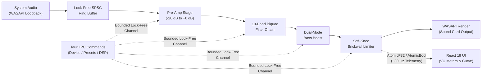

# Equilizer

<p align="center">
  
</p>

<p align="center">
  <strong>Lightweight, 100% Offline, Sub-15ms System-Wide Audio Equalizer Desktop Application for Windows.</strong>
</p>

<p align="center">
  <a href="#features"></a>
  <a href="#tech-stack"></a>
  <a href="#tech-stack"></a>
  <a href="#tech-stack"></a>
  <a href="#audio-safety--invariants"></a>
  <a href="#license"></a>
  <a href="#privacy--offline-guarantee"></a>
</p>

---

## Table of Contents

- [Overview](#overview)
- [Key Features](#key-features)
- [Audio Signal Chain & Architecture](#audio-signal-chain--architecture)
- [Tech Stack](#tech-stack)
- [Project Structure](#project-structure)
- [Audio Safety & Thread Invariants](#audio-safety--thread-invariants)
- [Factory Presets & Local Persistence](#factory-presets--local-persistence)
- [Getting Started](#getting-started)
  - [Prerequisites](#prerequisites)
  - [Installation](#installation)
  - [Development Workflow](#development-workflow)
  - [Verification & Quality Gates](#verification--quality-gates)
  - [Release Build](#release-build)
- [Privacy & Offline Guarantee](#privacy--offline-guarantee)
- [License](#license)

---

## Overview

**Equilizer** captures, shapes, and enhances all outbound operating system audio in real time on Windows with **sub-15ms round-trip latency** ($\le 13.33\text{ ms}$ verified), high-precision parametric filtering, dedicated dual-mode bass boost, and integrated soft-knee brickwall anti-clipping protection.

Unlike bloated alternatives built on Electron or requiring complex third-party kernel drivers and virtual audio cables, Equilizer runs as a lightweight native Windows desktop application powered by **Tauri v2** and **Rust** with native **WASAPI loopback audio capture** (<40 MB RAM, <3% CPU footprint).

---

## Key Features

- **Low-Latency WASAPI Pipeline:** High-performance loopback audio capture and hardware output streaming via Rust (`cpal`) with $\le 13.33\text{ ms}$ round-trip latency without audio stutter or buffer underrun.
- **10-Band Cascaded Parametric Equalizer:** Direct Form II Transposed cascaded biquad filters implementing Robert Bristow-Johnson (RBJ) formulas:
  - Topologies: `Peaking / Bell`, `Low Shelf`, `High Shelf`, `High Pass`, `Low Pass`.
  - Continuous ranges: Frequency ($20\text{ Hz} \text{ to } 20,000\text{ Hz}$), Gain ($-24\text{ dB} \text{ to } +24\text{ dB}$), and Q-factor ($0.1 \text{ to } 10.0$).
- **Dedicated Dual-Mode Bass Boost:** Resonant low-shelf enhancement stage with $0\text{ dB to } +12\text{ dB}$ gain fader and dual-mode frequency tuning:
  - `Sub-Bass` mode centered at $45\text{ Hz}$ for deep cinematic rumble.
  - `Punch` mode centered at $90\text{ Hz}$ for punchy kicks and gaming impact.
  - 10 ms smooth parameter interpolation eliminating zipper noise.
- **Master Pre-Amp Stage:** $-20\text{ dB to } +6\text{ dB}$ input attenuation fader with zero-cost unity bypass optimization ($G = 1.0$) and anti-zipper slew limiting.
- **Soft-Knee Brickwall Anti-Clipping Limiter:**
  - Absolute brickwall ceiling at $-0.1\text{ dBFS}$ ($0.988553$ linear) to prevent inter-sample DAC overs.
  - $0\text{ ms}$ lookahead delay to fully preserve the low-latency gaming/interactive budget.
  - $C^1$ continuous parabolic soft-knee curve transitioning smoothly into the ceiling without harmonic distortion.
  - Fast $1.0\text{ ms}$ envelope attack and smooth $50.0\text{ ms}$ release.
- **Interactive 60 FPS Visual Curve Editor:**
  - Real-time mathematical transfer function composite curve rendering on HTML5 Canvas.
  - Draggable filter nodes (X-axis for frequency, Y-axis for gain) with mouse-wheel Q bandwidth adjustments.
  - Real-time interactive frequency response plotting for composite filter chain + bass boost.
- **Tactile Band Inspector Strip:** Hardware/DAW-styled channel strip displaying active band parameters, filter type selector, frequency, gain, and Q with numeric inputs.
- **Stereo Peak VU Meters:** Smooth responsive peak meters with peak hold indicators, dBFS scales, and active limiter engagement indicators.
- **100% Offline Local JSON Persistence:** Atomic file writes to `%APPDATA%/equilizer/presets.json` and `settings.json`. Bundles 5 factory presets with protected write invariants.
- **Audio Endpoint Switching:** Dynamic playback device selection with automatic fallback to OS default endpoint.

---

## Audio Signal Chain & Architecture

Equilizer strictly decouples real-time audio threads from application logic and the UI presentation layer:



### Signal Processing Order in Audio Thread
$$\text{Input Audio} \longrightarrow \text{Pre-Amp} \longrightarrow \text{10-Band EQ} \longrightarrow \text{Bass Boost} \longrightarrow \text{Soft-Knee Limiter} \longrightarrow \text{Output}$$

---

## Tech Stack

| Subsystem | Technology | Purpose |
|---|---|---|
| **Host & Packaging** | [Tauri v2](https://v2.tauri.app/) (Rust 1.75+) | Native desktop windowing, system tray, security sandbox |
| **Audio Capture & Render** | [`cpal`](https://crates.io/crates/cpal) 0.15 | Low-latency Windows WASAPI loopback capture & output |
| **Biquad DSP Engine** | Direct Form II Transposed Math | Robert Bristow-Johnson formulas, denormal suppression |
| **Thread Communication** | [`crossbeam-channel`](https://crates.io/crates/crossbeam-channel) + `AtomicF32` | SPSC bounded lock-free queues and atomic telemetry |
| **Local Storage** | [`serde`](https://crates.io/crates/serde) + [`serde_json`](https://crates.io/crates/serde_json) | Atomic local JSON configuration in `%APPDATA%/equilizer/` |
| **Frontend Framework** | [React 19](https://react.dev/) + [TypeScript](https://www.typescriptlang.org/) | Type-safe presentation layer |
| **Styling** | [Tailwind CSS v4](https://tailwindcss.com/) + [Lucide React](https://lucide.dev/) | Hardware/DAW-inspired tactile dark workstation theme |
| **Visual Curve Canvas** | HTML5 Canvas 2D API | 60 FPS mathematical transfer function and spline plotting |

---

## Project Structure

```text
equilizer/
├── desktop/                         # Desktop application root
│   ├── src/                         # React 19 + TypeScript frontend
│   │   ├── components/
│   │   │   ├── canvas/              # 60 FPS interactive curve editor & nodes
│   │   │   ├── deck/                # Bottom control deck (Bass Boost, Preamp, VU meters)
│   │   │   ├── header/              # Header bar, preset & device dropdowns
│   │   │   ├── inspector/           # 10-band parameter inspector strip
│   │   │   ├── layout/              # Workstation shell & layout containers
│   │   │   └── modals/              # Save preset & delete confirmation dialogs
│   │   ├── hooks/                   # useAudioTelemetry & UI state hooks
│   │   ├── lib/                     # Biquad math transfer function & coordinate mappings
│   │   ├── styles/                  # Tailwind CSS tokens & theme styling
│   │   └── types/                   # Audio & preset TypeScript definitions
│   │
│   └── src-tauri/                   # Rust backend & DSP core
│       └── src/
│           ├── audio/               # Real-time DSP audio engine
│           │   ├── bass_boost.rs    # Dual-mode tuned resonant bass engine
│           │   ├── benchmark.rs     # Latency & buffer underrun benchmark harness
│           │   ├── buffer.rs        # Lock-free SPSC circular ring buffer
│           │   ├── capture.rs       # WASAPI loopback audio capture
│           │   ├── dsp.rs           # 10-band Direct Form II Transposed biquad filters
│           │   ├── limiter.rs       # Soft-knee anti-clipping brickwall limiter
│           │   ├── params.rs        # Lock-free atomic parameter exchange & DspProcessor
│           │   ├── pipeline.rs      # AudioPipeline loopback coordinator
│           │   ├── preamp.rs        # Input attenuation & boost stage
│           │   └── render.rs        # Low-latency WASAPI playback render
│           ├── commands/            # Tauri IPC command handlers
│           │   ├── devices.rs       # get_audio_devices & set_output_device
│           │   └── dsp.rs           # EQ bands, bass boost, preamp & bypass IPC
│           ├── storage/             # 100% offline local JSON persistence
│           │   ├── models.rs        # EqualizerPreset, AppConfig, EqBand schemas
│           │   └── mod.rs           # StorageManager & atomic write engine
│           ├── state.rs             # Thread-safe managed AppState
│           ├── audio_safety.rs      # Math converters & denormal suppression
│           └── lib.rs               # Application entry point & command router
├── prompts/                         # Implementation prompt records
└── projectworkflow.md               # Master blueprint & architectural specification
```

---

## Audio Safety & Thread Invariants

Equilizer strictly adheres to professional real-time audio engineering safety standards:

1. **Zero Allocations in Audio Callbacks:** Real-time audio threads NEVER allocate heap memory (`Vec::new`, `Box`, `String`, format strings). All buffers and delay registers are pre-allocated during stream initialization.
2. **Zero Locks in Audio Processing:** No `std::sync::Mutex` or `std::sync::RwLock` exists in the real-time audio path. Parameter exchanges occur exclusively through lock-free bounded SPSC channels (`crossbeam-channel::bounded(128)`) or atomic registers (`AtomicF32`, `AtomicBool`).
3. **Denormal Number Flushing:** Every filter stage flushes IEEE-754 denormal numbers ($|sample| < 10^{-15}$) to zero to prevent severe CPU performance degradation on silence or decay tails.
4. **Parameter De-zippering:** All user-controlled continuous parameters (Pre-Amp gain and Bass Boost) employ smoothing slew rate limiters ($10\text{ ms}$ time constant) to eliminate zipper noise and audible clicks.
5. **Brickwall Headroom Guard:** The soft-knee limiter guarantees output samples never exceed $-0.1\text{ dBFS}$ ($0.988553$ linear), safeguarding against digital clipping even with maximum $+12\text{ dB}$ bass boost.

---

## Factory Presets & Local Persistence

Equilizer persists all configuration in 100% offline local JSON files in the operating system's application data directory:
- Windows: `%APPDATA%\equilizer\` (`C:\Users\<User>\AppData\Roaming\equilizer\`)
  - `presets.json`: Factory and user-created custom equalizer presets.
  - `settings.json`: Application settings (selected audio device, active preset, bypass state, limiter status).

### Bundled Factory Presets
| Preset | Pre-Amp | Bass Boost Mode & Gain | Intended Profile |
|---|---|---|---|
| **Flat** | $0.0\text{ dB}$ | Disabled ($0.0\text{ dB}$) | Neutral studio reference pass-through |
| **Deep Bass** | $-3.0\text{ dB}$ | Sub-Bass ($45\text{ Hz}$) @ $+6.0\text{ dB}$ | Cinematic low-end rumble for subwoofers & bass-heavy genres |
| **Punchy Gaming** | $-2.0\text{ dB}$ | Punch ($90\text{ Hz}$) @ $+4.5\text{ dB}$ | Enhanced footsteps, gunshot transients, and competitive gaming |
| **Crisp Vocals** | $-1.0\text{ dB}$ | Disabled ($0.0\text{ dB}$) | Podcast, dialogue, and vocal clarity enhancement |
| **Rock** | $-2.5\text{ dB}$ | Punch ($90\text{ Hz}$) @ $+3.0\text{ dB}$ | Classic energetic V-shaped contour with tight punch |

> [!NOTE]
> Factory presets are immutable and protected at the storage layer from deletion or modification. User modifications can be saved as new custom presets.

---

## Getting Started

### Prerequisites

- **Operating System:** Windows 10 (Build 19041+) or Windows 11
- **Rust Toolchain:** Rust 1.75+ (`stable-x86_64-pc-windows-msvc`) with Cargo
- **Node.js:** Node.js 18.x or 20.x+ (with npm)
- **Visual Studio C++ Build Tools:** C++ build tools installed via Visual Studio Installer

### Installation

1. Clone the repository:
   ```powershell
   git clone https://github.com/gnjohnny/equilizer.git
   cd equilizer/desktop
   ```

2. Install frontend dependencies:
   ```powershell
   npm install
   ```

### Development Workflow

Start the Tauri development desktop environment with Hot Module Replacement (HMR):
```powershell
npm run tauri dev
```

### Verification & Quality Gates

Run the comprehensive automated test suites and linting checks:

```powershell
# Frontend type safety & code style
npm run typecheck
npm run lint

# Backend Rust unit tests & DSP verification (71 tests)
cargo test --manifest-path src-tauri/Cargo.toml

# Strict clippy linter (zero warnings policy)
cargo clippy --manifest-path src-tauri/Cargo.toml -- -D warnings
```

### Release Build

To package a standalone, optimized Windows production binary and installer (`.msi` / `.exe`):
```powershell
npm run tauri build
```
The output installers will be generated under `desktop/src-tauri/target/release/bundle/`.

---

## Privacy & Offline Guarantee

- **Zero Cloud Connectivity:** Equilizer contains zero external HTTP/HTTPS network calls, WebSocket connections, telemetry trackers, or third-party analytics SDKs.
- **100% Local Execution:** All DSP calculations, audio buffering, and configuration persistence execute strictly on the local machine.
- **No Background Telemetry:** Your listening habits, audio output, and audio content never leave your machine.

---

## License

This project is licensed under the [MIT License](LICENSE).
